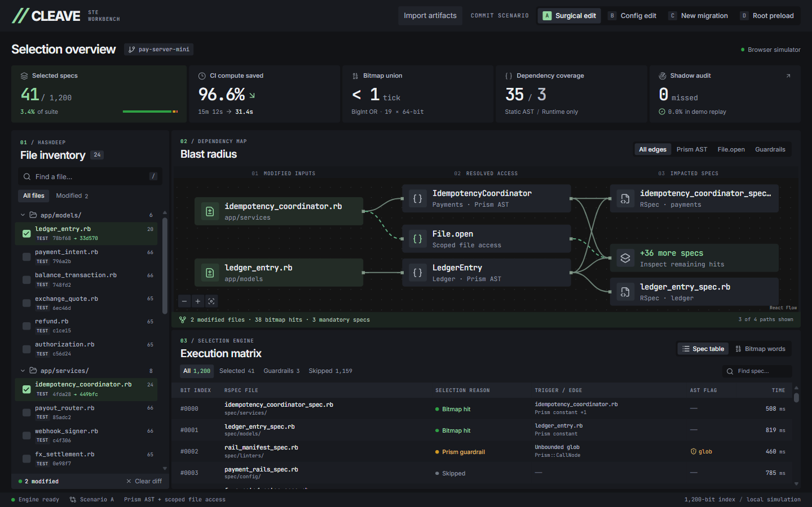
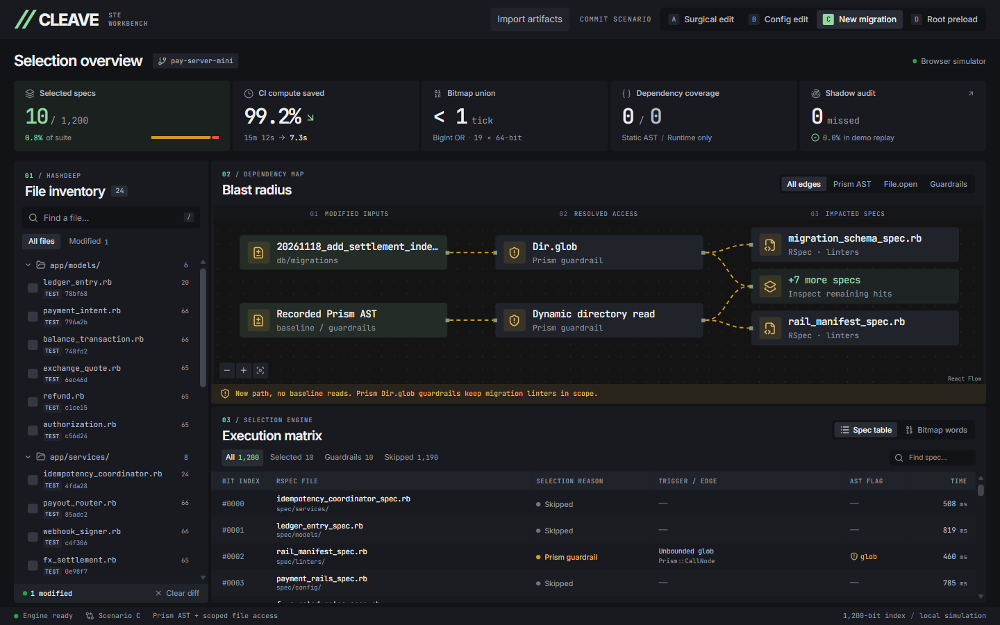
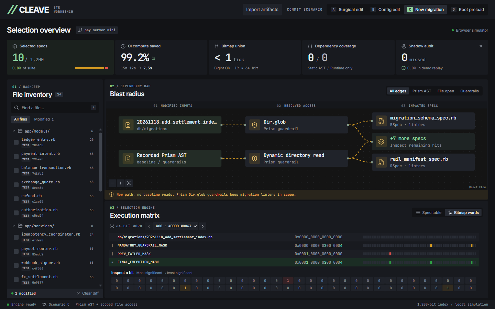
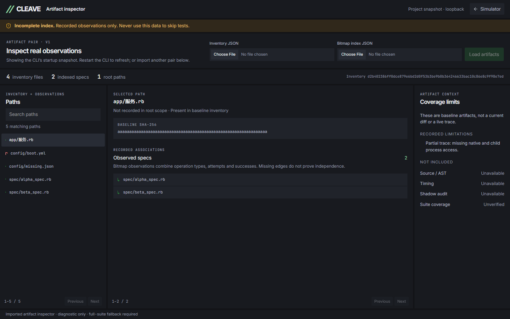
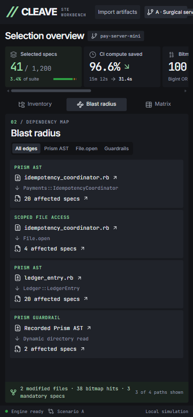

# Cleave

Cleave is a selective test execution workbench and diagnostic toolkit for Ruby and RSpec. It combines Prism static AST analysis, scoped runtime file access tracing, compact bitmap indexes, and an interactive browser-based workbench to analyze and optimize test suite execution.

**Live Demo:** [https://sehaan-1.github.io/Cleave/](https://sehaan-1.github.io/Cleave/)

---

## Screenshots

### Selection overview and blast radius

Dependency map, inventory, and execution matrix for a surgical edit. The status bar reports the live bitmap union and CI compute saved.



### Prism guardrails on a new migration

Scenario C adds a migration with no baseline reads. Prism `Dir.glob` guardrails keep the affected linter specs in scope instead of silently dropping them.



### Bitmap words

Inspect the 64-bit `MANDATORY_GUARDRAIL_MASK`, `PREV_FAILED_MASK`, and `FINAL_EXECUTION_MASK` words for the current selection.



### Ruby loopback artifact inspector

`bundle exec cleave ui` serves the packaged workbench directly from Ruby. Here it inspects a real artifact pair with coverage limits and recorded observations.



### Compact layout

The workbench reflows to a panel switcher on small screens without horizontal page overflow.



---

## Quick Start

### 1. Interactive Workbench (UI)

The UI workbench lets you explore dependency graphs, bitmap allocations, and test selection plans.

**Running with Node.js (v22.12+):**
```sh
npm ci
npm run dev        # Launch development server
npm run build      # Build production bundle
npm run preview    # Preview production bundle
npm test           # Run unit tests
npm run test:e2e   # Run Playwright browser tests
```

**Running directly from Ruby (no Node required):**
The gem packages the prebuilt workbench:
```sh
bundle exec cleave ui                 # Opens workbench on 127.0.0.1
bundle exec cleave ui --port 4321     # Specify loopback port
bundle exec cleave ui --no-open       # Print URL without launching browser
bundle exec cleave ui --plan          # Preload diagnostic project selection plan
```

---

### 2. Ruby CLI & Runner

Add `cleave-ste` and `rspec` to your `Gemfile` and run `bundle install`.

#### Run RSpec Suite
```sh
bundle exec cleave                    # Run serial RSpec suite with JSON telemetry
bundle exec cleave run --workers 4    # Run across parallel worker processes
```

#### Trace & Generate Artifacts
Trace file accesses during an RSpec run to generate `.cleave/inventory.json` and `.cleave/bitmap_index.json`:
```sh
# Trace serial execution and build baseline bitmap index
bundle exec cleave run --trace --index

# Include forked subprocess observations (best-effort)
bundle exec cleave run --trace --trace-forks --index

# Include specific generated or untracked files
bundle exec cleave run --trace --index --include schema.json --include spec/extra_spec.rb
```

#### Verify Artifact Provenance
Check if local artifacts match the latest signed run marker:
```sh
bundle exec cleave provenance
```

#### Diagnostic Test Planning
Preview which specs are affected by recent code changes:
```sh
# Standard bitmap selection plan
bundle exec cleave plan

# Include previous test run failures
bundle exec cleave plan --previous-failures

# Include approximate Prism static dependency analysis
bundle exec cleave plan --static-dependencies

# Export plan to JSON
bundle exec cleave plan --static-dependencies --previous-failures > .cleave/plan.json
```

#### Shadow Verification
Run the configured full suite in shadow mode to verify diagnostic candidate accuracy against actual observed test failures:
```sh
bundle exec cleave run --verify
```

#### Export Dependency Graph
Generate a self-contained, offline interactive HTML dependency graph:
```sh
bundle exec cleave graph --output .cleave/graph.html
```

---

## Core Architecture

Cleave operates across four primary stages:

```
[Prism AST Analysis] ──┐
                       ├─► [.cleave/ Artifacts] ──► [Diagnostic Planner] ──► [Workbench UI]
[Runtime File Tracing] ┘   (Inventory & Bitmaps)    (Prism + Bitmaps + Guardrails)
```

1. **Static Analysis (`Cleave::StaticAnalysis`)**:
   Uses Prism to parse Ruby source files, tracking constant declarations, `require_relative` calls, and identifying dynamic hazards (such as `eval`, `const_get`, dynamic `send`).

2. **Scoped Runtime Tracing (`Cleave::ScopedTrace`)**:
   Observes filesystem reads (`File.open`, `IO.read`, `YAML.load_file`, `Kernel.require`) within spec scopes. Supports fiber-local tracking and opt-in fork observation (`--trace-forks`).

3. **Compact Bitmap Indexing (`Cleave::BitmapIndex`)**:
   Maps tracked repository files to contiguous bit positions representing spec associations, producing versioned JSON artifacts with SHA-256 integrity verification.

4. **Guardrail Planning & Safe Fallbacks (`Cleave::Guardrails`)**:
   Combines bitmap lookups, Prism hazard checks, root-scope changes, and prior failure records. In v1, any unmapped change or dynamic ambiguity automatically triggers a safe full-suite fallback.

---

## Ruby Library API

You can also use Cleave programmatically within Ruby:

```ruby
require "cleave"

# 1. Static repository scan
scanned_files = Cleave::StaticAnalysis.scan(Dir.pwd)

# 2. Runtime access tracing
report = Cleave::ScopedTrace.record(root: Dir.pwd) do
  # Run RSpec examples or application code here
end

# 3. Capture content inventory & build bitmap index
inventory = Cleave::Inventory.capture_git(root: Dir.pwd)
index = Cleave::BitmapIndex.build(
  inventory: inventory,
  root: Dir.pwd,
  specs: ["spec/models/user_spec.rb"],
  reports: [report]
)

# 4. Save & load artifacts
Cleave::Artifacts.write(".cleave", inventory: inventory, index: index)
loaded_inv, loaded_idx = Cleave::Artifacts.read(".cleave")

# 5. Calculate selection preview
result = Cleave::Selection.select(
  baseline: loaded_inv,
  current: Cleave::Inventory.capture_git(root: Dir.pwd),
  index: loaded_idx,
  current_specs: ["spec/models/user_spec.rb"]
)
```

---

## Safety & Design Philosophy

- **Diagnostic Preview**: V1 plans provide diagnostic visibility into test dependencies. They report candidate subsets alongside fallback reasons, ensuring the full suite remains required whenever dynamic or root-level changes occur.
- **Fail-Closed Verification**: The runner and indexer validate file hashes, UTF-8 paths, and schema versions; any inconsistency or missing file immediately aborts execution safely rather than guessing.
- **Process Isolation**: Parallel workers run in dedicated processes to avoid state bleeding.
